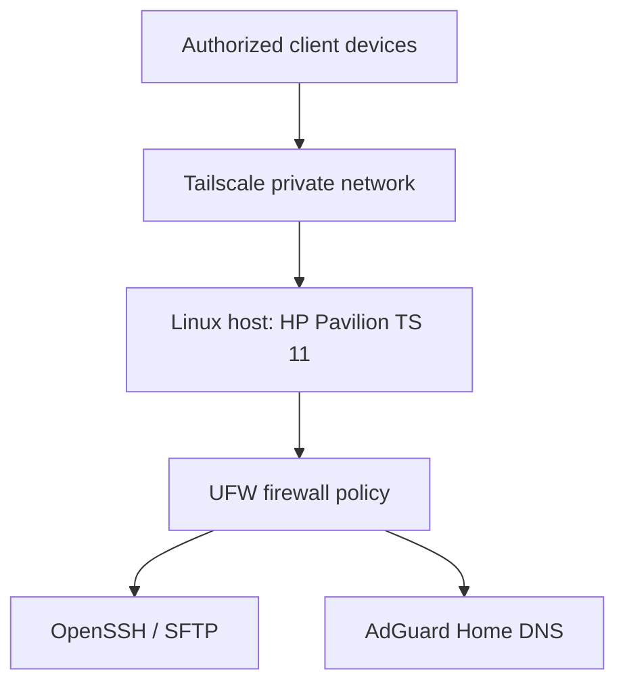

# Architecture

This is a **conceptual** architecture based on the services described for this homelab. Verify the actual paths and configuration before presenting this as the live design.

## Components

- **Linux host:** runs the services.
- **Tailscale:** provides private connectivity for enrolled devices.
- **OpenSSH / SFTP:** provides encrypted file transfer and potentially SSH administration.
- **UFW:** enforces host firewall policy.
- **AdGuard Home:** handles DNS queries from clients configured to use it.

## Verify before publishing

- Whether SSH and SFTP are restricted to Tailscale, LAN, or another interface.
- Whether AdGuard Home runs directly on the host, in a container, or on another device.
- Whether Tailscale clients are configured to use AdGuard Home as DNS.
- Which interfaces and ports are actually listening.
